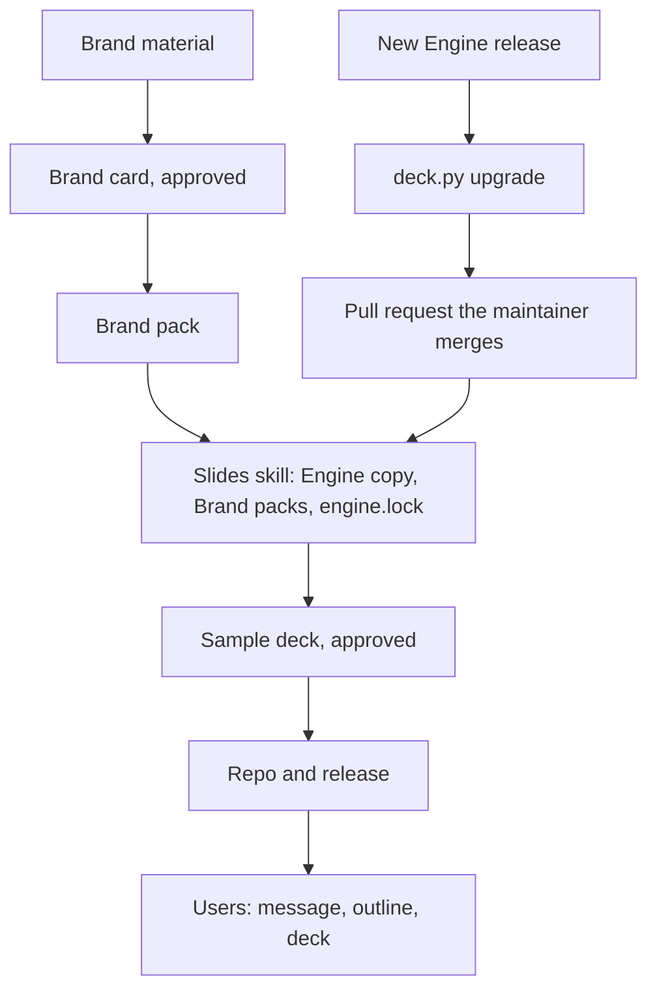

# slides-skill-creator

Give your coding agent your brand: get a skill that builds on-brand HTML slide decks, and keeps
getting the shared Engine's fixes.

[](https://github.com/hoaj/slides-skill-creator/actions/workflows/ci.yml)
[](./LICENSE)

slides-skill-creator is a **Generator** for coding agents (Claude Code, Cursor, GitHub Copilot
CLI). From a brand's guidelines, logo, fonts, icons or PowerPoint template it makes a **Slides
skill**: a plugin in a repo you own that builds decks as one self-contained HTML file, which
presents, edits inline and exports to PDF or editable PowerPoint. The brand lives in a **Brand
pack** (data, CSS, an SVG logo, fonts and icons, no code). The code that builds decks is the
**Engine**, a versioned copy of this repo's [`engine/`](./engine), and `deck.py upgrade` moves a
Slides skill to a newer Engine in a pull request. The terms are defined in
[GLOSSARY.md](./GLOSSARY.md).

## When to use it, and when not

Use it when a team makes decks for one or more brands often and wants an agent to make them on
brand, from a message to an approved outline to a finished deck.

Do not use it to:

- edit a `.pptx` in place. A Slides skill converts one into a web deck instead.
- make a one-off deck with no brand to follow.
- draw a standalone chart.

## Quickstart

Prerequisites: Python 3.8 or newer and the [GitHub CLI](https://cli.github.com), logged in
(`gh auth login`). When the brand has font files, as the Acme sample does, also
`python3 -m pip install fonttools brotli`.

Install the Generator.

Claude Code:

```text
/plugin marketplace add hoaj/plugins
/plugin install slides-skill-creator@hoaj
```

GitHub Copilot CLI:

```sh
copilot plugin marketplace add hoaj/plugins
copilot plugin install slides-skill-creator@hoaj
```

Cursor: Settings, Plugins, Add marketplace, `hoaj/slides-skill-creator`, then install
**slides-skill-creator**. Cursor's marketplaces cannot list a plugin from another repo, so this
repo has its own.

Then ask your agent. To try it on the fictional brand Acme first:

```text
Make a slides skill for Acme from the sample brand material that comes with slides-skill-creator.
```

For your own brand, name it and point to its material:

```text
Make a slides skill for <brand>. The guidelines, logo, fonts and PowerPoint template are in <folder>.
```

The agent copies the material to a working folder outside every repo, then waits for your yes
three times before it writes anything:

1. **The brand card:** every colour, font, logo, icon set and alias it found, each with its source,
   and questions about what is missing.
2. **The skill's name and trigger description**, for example `acme-slides`, and then the GitHub
   repo, its visibility and the author name for the manifests.
3. **The Sample deck:** one deck that shows every theme, layout, widget and icon in the brand.
   Page through it and name what to change.

On the way it offers a short **Playbook** interview about how your team makes decks (you can skip
it). Then it creates the repo, private unless you choose public, and pushes. Its CI checks the
Brand pack and builds the Sample deck, and its release workflow publishes the first version. To
put the skill in a marketplace repo you already have, say so: the Generator adds it there in a
pull request instead (`new --into`).

Install the new skill from its repo the same way as above, then:

```text
Make a deck for Acme about our third-quarter results.
```

## How it works



A Slides skill holds:

- `engine/`: a copy of the Engine. Leave it as it is, so upgrades merge cleanly.
- `brands/<slug>/`: one Brand pack per brand. Brand differences go here.
- `engine.lock`: the Engine release the copy came from.
- a thin `SKILL.md` that hands off to `engine/workflow.md`, and a `<skill>-feedback` skill that
  files issues in the skill's own repo.

| Mode | Use it when | Guide |
|---|---|---|
| `new` | a brand has no Slides skill yet | [reference/new.md](./skills/slides-skill-creator/reference/new.md) |
| `add-brand` | another brand joins an existing Slides skill | [reference/add-brand.md](./skills/slides-skill-creator/reference/add-brand.md) |
| `edit-brand` | a Brand pack's fonts, icons, colours, themes, layouts, Playbook, Deck types or PowerPoint calibration change | [reference/edit-brand.md](./skills/slides-skill-creator/reference/edit-brand.md) |

### Upgrading a Slides skill

In the Slides skill's repo, ask the agent to upgrade it, or run:

```sh
python3 <skill>/engine/deck.py upgrade
```

`<skill>` is `skills/<name>-slides` in a repo of its own, and
`plugins/<name>-slides/skills/<name>-slides` in a shared marketplace repo.

It verifies the release (an immutable GitHub release with attested assets), merges the new Engine
and Starter files three ways, migrates the Brand packs, rebuilds and compares each Sample deck,
and opens a pull request. When something needs a decision, the agent resolves it and explains it
in the pull request. You merge.

### Testing the trigger

A Slides skill only helps when the agent starts it for the right requests and leaves other
requests alone. `deck.py check`, which CI runs, checks the description for free: it must name
every brand and alias and say what the skill is not for. When the description changes, the
Generator offers the live evals, which need Claude Code and cost tokens:

```sh
python3 <skill>/engine/deck.py eval
```

Each case runs three times. A deck request for each brand and alias must start the skill at
least twice, and a request it must not handle (an unknown brand, a `.pptx` fix) must never start
it. The report stays on your machine.

## Fonts and licences

Every deck embeds the Brand pack's fonts, and a public Slides skill repo publishes them. The
Generator does not check font licences: **you are responsible for having the right to embed and
distribute the fonts** you give it. Keep each font's licence in the pack's `licenses/` folder.

This repo is MIT licensed. The Engine bundles [PptxGenJS](https://github.com/gitbrent/PptxGenJS)
and its dependencies under their own licences, in [`engine/licenses/`](./engine/licenses). The
`acme` sample material uses Public Sans (SIL Open Font License 1.1) and Phosphor Icons (MIT).

## What is supported

| | |
|---|---|
| Coding agents | Claude Code, Cursor and GitHub Copilot CLI. Codex is the first follow-up |
| Python | 3.8 or newer, standard library only for building decks |
| Optional, as `deck.py doctor` reports | `python-pptx` and `playwright` for PowerPoint export and import; `fonttools` and `brotli` for font files; `numpy`, `pymupdf` and `pillow` with Chrome for `compare` |
| PowerPoint calibration | optional; exported through PowerPoint on macOS, or by hand elsewhere |
| Trigger evals | Claude Code 2.1.269 or later |
| Releases | one `vX.Y.Z` line; `deck.py upgrade` needs `git` and `gh` 2.81 or later, logged in, because it verifies the release with GitHub and opens a pull request |

## Contributing and feedback

A problem with the Generator: ask your agent to report it, and the `slides-skill-creator-feedback`
skill drafts a public issue for your approval. A problem in a Slides skill goes to that skill's
own repo first; its maintainer forwards Engine bugs here as a neutral reproduction on the
built-in `plain` pack, never with brand material.

Run the tests with `python3 -m unittest discover -s tests -t .`, and the Generator's trigger
evals with `python3 scripts/trigger_evals.py run` (Claude Code, costs tokens). Development
follows the [v0.1.0 map](https://github.com/hoaj/slides-skill-creator/issues/1).

## License

[MIT](./LICENSE)
